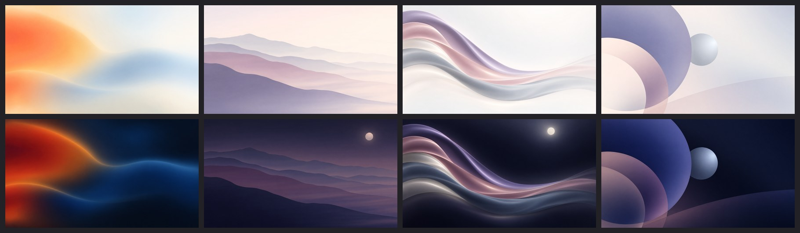
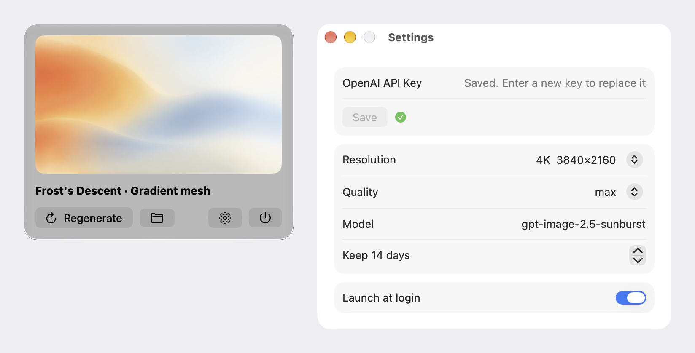

# Macchiato

[](https://github.com/nervouna/macchiato/actions/workflows/ci.yml)
[](https://github.com/nervouna/macchiato/releases/latest)

[](LICENSE)



Macchiato is a macOS menu bar app that generates a light and a dark 4K abstract wallpaper every day with OpenAI's image API, and shows the one that matches the system appearance on every display. The colours follow the Chinese solar-term calendar (二十四节气).

## Status

- For anyone who wants a calm, new wallpaper each day and brings their own OpenAI API key.
- Version 1.0, used daily by its author on macOS 27. The deployment target is macOS 14; it has not been tried on macOS 14 to 26.
- Needs an OpenAI API key that can use an image model (default `gpt-image-2.5-sunburst`). Generation is billed to that key: about US$0.40 per image at the default settings and two images a day, per OpenAI's price calculator when this was written.
- The interface is in English and Simplified Chinese and follows the system language.
- Releases are Developer ID signed, notarized zips on the [Releases](https://github.com/nervouna/macchiato/releases) page.
- See [CONTRIBUTING.md](CONTRIBUTING.md) and [SECURITY.md](SECURITY.md).

## What it does

- **Abstract art, not scenery.** Photoreal landscapes showed repetitive lattice-like textures at wallpaper size, which abstract forms avoid.
- **Colours follow the 24 solar terms.** There is one palette per term, and the day a term begins adds a small accent colour.
- **Four styles in rotation.** Gradient mesh, layered paper-cut hills, satin ribbons and geometric circles. The style changes daily and the composition every four days.
- **A matching dark version.** The light image is rendered first, then the dark one is an edit of it, so the shapes are identical and only the tone changes. After each render the mean luminance is checked and an image that is too dark or too light is redrawn, up to three times.
- **Switches by itself.** The wallpaper changes with the system appearance, after wake and when displays change.
- **Runs on its own.** It generates at midnight, and at launch or after wake if today's pair is missing. Transient failures (no network, rate limits) are retried every 30 minutes. A rejected key stops the retries until you change it. A failure shows a notification and keeps the previous wallpaper.

## Install

1. Download `Macchiato-<version>.zip` from [Releases](https://github.com/nervouna/macchiato/releases), unzip it and move `Macchiato.app` to `/Applications`.
2. Open it. A half-filled circle appears in the menu bar.
3. Click it, open Settings (the gear) and paste your OpenAI API key. Today's pair is generated right away and takes a few minutes at the default quality.



The release build adds itself to Login Items on first launch; Settings has the switch.

Settings: API key, resolution (4K or 2K), quality, model name, days of images to keep, launch at login.

## Privacy and data

- Each day the app sends the day's text prompt to `api.openai.com` with your key, and sends the light image back for the dark edit. It talks to no other host and has no analytics.
- The key is stored in the macOS Keychain (item `io.damao.macchiato`). Setting the `MACCHIATO_OPENAI_API_KEY` environment variable overrides it.
- Images, `prompts.json` and `current.json` live in `~/Library/Application Support/Macchiato/`, under `days/YYYY-MM-DD/<size>/`.
- To uninstall: quit the app, delete it, delete that folder, remove the Keychain item and the Login Items entry.

If OpenAI answers 404 for the model, your account may not have access to it. Change Model in Settings to an image model you can use.

## Command line

The app binary can also run without showing any interface:

```bash
Macchiato.app/Contents/MacOS/Macchiato --print-prompt 2026-11-07
Macchiato.app/Contents/MacOS/Macchiato --once [--date YYYY-MM-DD] [--size 2560x1440] [--force] [--no-apply]
MACCHIATO_OPENAI_API_KEY=... Macchiato.app/Contents/MacOS/Macchiato --save-key
```

## Build from source

Needs Xcode and [XcodeGen](https://github.com/yonaskolb/XcodeGen) (`brew install xcodegen`).

```bash
scripts/build.sh [debug|release]     # build/Macchiato.app
scripts/release.sh [--skip-notarize] # build/release/Macchiato-<version>.zip and its .sha256
xcodebuild -project Macchiato.xcodeproj -scheme Macchiato -destination 'platform=macOS' test
```

A release build is signed with the Developer ID identity in your keychain, with the hardened runtime. `scripts/release.sh` notarizes and staples it only when `${XDG_CONFIG_HOME:-$HOME/.config}/macchiato/signing.env` defines `MACCHIATO_NOTARY_KEY` (key file path), `MACCHIATO_NOTARY_KEY_ID` and `MACCHIATO_NOTARY_ISSUER_FILE` (a file holding the issuer ID), and optionally `MACCHIATO_CODESIGN_IDENTITY` and `MACCHIATO_TEAM_ID`. The key file is passed to `notarytool` by path and never read, and the issuer ID is never printed. Without these settings the zip is signed only.

Layout: `App/Core` (solar terms and prompts, OpenAI client, generator, wallpaper service, storage), `App/UI` (panel and settings), `App/AppModel.swift` (state and schedule), `App/CommandLineTool.swift`, `App/AppIcon.icon` (Icon Composer document, notes in [design/README.md](design/README.md)), `Tests`, `project.yml` (XcodeGen).

## License

[MIT](LICENSE). Macchiato is an independent project and is not affiliated with or endorsed by OpenAI or Apple.
